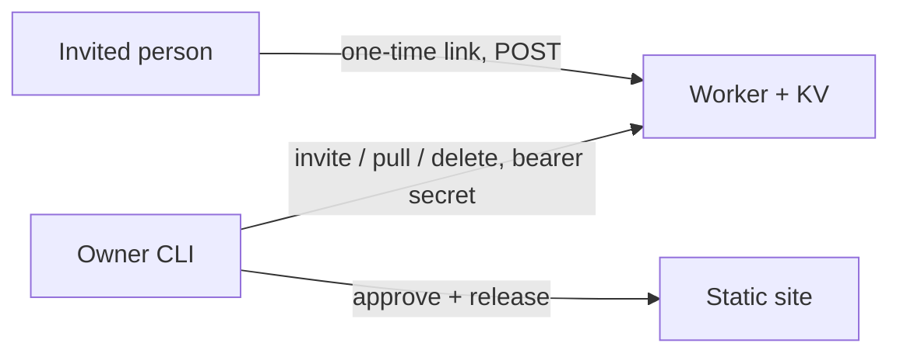

# Review intake runbook

Invite-only form that sends recommendations to a separate Cloudflare Worker. Decision: [ADR-0010](../30-decisions/ADR-0010-invite-only-review-intake-worker.md) (`Proposed`). Spec and tasks: `specs/next-reviews-intake`. Publishing rules: [testimonials runbook](testimonials.md).



## State

Code and tests are done (`services/reviews`, `scripts/testimonial.mjs`, the request page). **Deployed on 2026-10-20** to the personal Cloudflare account as `naindev-reviews` with the custom domain `reviews.naindev.com` (B-018 to B-020 done, checked with `/v1/health`, an invitation and `pull`). The public page keeps the email flow until the owner approves the privacy section (B-021) and `PUBLIC_REVIEWS_ENDPOINT` is set in the deploy workflow.

The wrangler login has two accounts (the personal one and a separate infrastructure account): set `CLOUDFLARE_ACCOUNT_ID` to the personal account id before running wrangler commands, so nothing is created in the other one. `wrangler login` with the default callback times out after about two minutes; `wrangler login --device` gives a code and five minutes.

## Set up (owner, once)

1. `cd services/reviews && npx wrangler login` (opens the browser), then `npx wrangler whoami` to confirm the account.
2. **B-018** Create the KV namespace: `npx wrangler kv namespace create REVIEWS`, then put the printed id in `wrangler.toml`.
3. **B-019** `npx wrangler deploy` creates the Worker `naindev-reviews` and, through the `custom_domain` route in `wrangler.toml`, the DNS record for `reviews.naindev.com`. It fails if that hostname already has a CNAME record.
4. **B-020** Generate a random admin secret (`[Convert]::ToHexString([Security.Cryptography.RandomNumberGenerator]::GetBytes(32))` in PowerShell 7) and store it only as a Worker secret: `npx wrangler secret put ADMIN_TOKEN` (run after the first deploy). Keep a copy in a password manager.
5. Optional: a Cloudflare WAF rate-limit rule on `reviews.naindev.com` as a second layer (the Worker already limits 20 requests per address per hour).
6. Check: `curl -sI https://reviews.naindev.com/v1/health` answers 200.
7. In your shell (never committed): `REVIEWS_ENDPOINT=https://reviews.naindev.com` and `REVIEWS_ADMIN_TOKEN=<the secret>`.
8. **B-021** Approve the privacy section (draft below), add it to `src/pages/privacidad.astro`, and only then set `PUBLIC_REVIEWS_ENDPOINT=https://reviews.naindev.com` in the build step of `.github/workflows/deploy.yml`.

## Daily use

```sh
npm run testimonial -- invite "David (Contrast3D)" --relationship partner   # prints a single-use link
npm run testimonial -- pull                                                  # brings submissions in as pending
npm run testimonial -- approve <id>                                          # or: reject <id>
```

Send the link in the channel the person already uses. It works once and expires (14 days by default, `--days` changes it). Then follow the testimonials runbook: written confirmation to publish, English translation review, `npm run check`, commit.

`pull` deletes each submission from the service once it is stored locally (`--keep` keeps it). Pending entries must be approved or rejected before any commit: the repository is public and a test fails otherwise.

## Rotate or recover

- **Rotate the admin secret:** `npx wrangler secret put ADMIN_TOKEN` with a new value, then update `REVIEWS_ADMIN_TOKEN`. Old CLI sessions stop working immediately.
- **A link leaked or was lost:** it cannot be recovered (only its hash is stored). Create a new invitation; the old one expires by itself.
- **Withdrawn consent:** delete the entry from `src/data/testimonials.json`, release, and remove any copy still in the service (`DELETE /v1/admin/submissions/<id>` through the CLI is not wrapped; use the Cloudflare dashboard to delete the key `sub:<id>`).
- **Service down:** the site is unaffected; the page shows the email fallback message.
- **Consent text changed:** bump `CONSENT_VERSION` in `services/reviews/src/worker.mjs` and the text on the request page together.

## Privacy section draft (for B-021, Spanish, to be reviewed by the owner)

> **Recomendaciones.** Si te invito a dejar una recomendación, tratamos tu nombre, cargo, empresa, los enlaces que añadas y el texto que escribas, con tu consentimiento, para decidir si lo publico en naindev.com. Se guardan en un servicio alojado en Cloudflare (encargado del tratamiento) hasta un máximo de 60 días si no se procesan; lo que no se publique se elimina. Si se publica, se publica con tu nombre, cargo y empresa. No usamos cookies ni rastreadores en este formulario. Puedes retirar tu consentimiento o pedir acceso, rectificación o supresión escribiendo a contact@naindev.com. El repositorio de la web es público: lo retirado de la web puede seguir visible en el historial de cambios.

## Known limits

- KV is eventually consistent: two submissions with the same link inside a few milliseconds could both be stored. The owner would see two pending entries and discard one.
- The honeypot and the rate limit stop simple bots, not a person who really received a link.
- The per-address counter writes to KV on every public request, and the Cloudflare free plan allows 1,000 KV writes a day (checked 2026-10-19 on the KV pricing page). A flood could use that quota up and make the form answer errors until 00:00 UTC. Nothing is exposed (availability only); the WAF rate-limit rule in step 5 absorbs most of it, and a paid Workers plan raises the quota.
