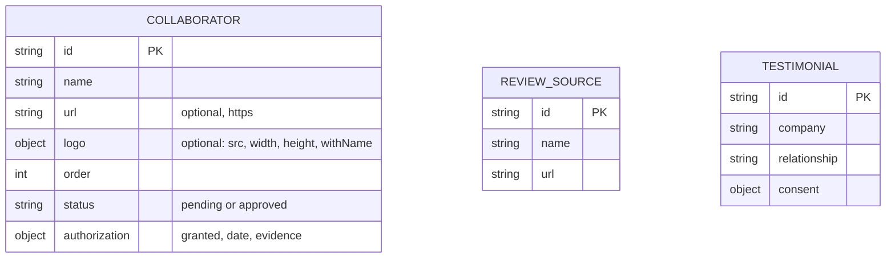
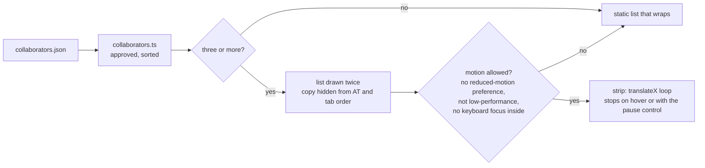

# Implementation plan: Clients and collaborators bar

Status: Draft

## Modules

- **Data**: `src/data/collaborators.json` and `src/data/review-sources.json`, loaded as content collections `collaborators` and `reviewSources` in `src/content.config.ts`; logo files under `public/assets/images/collaborators/`. Covers CLB-001, CLB-006, CLB-008.
- **Rules**: `src/utils/collaborators.ts`, pure functions with no Astro import: `approvedCollaborators(entries)` (approved only, sorted by `order` then name), `movesAsStrip(count)` and `stripLoopSeconds(count)`. The component presents; this module decides what is shown and when it moves. Covers CLB-003, CLB-009.
- **Bar**: `src/components/home/CollaboratorsBar.astro`, presentational, receives the selected entries. The heading, the pause control and the list, drawn twice when it moves. Covers CLB-003, CLB-004, CLB-009, CLB-012.
- **Section**: `src/components/home/Testimonials.astro` keeps its place in `index.astro` (HN-001 unchanged) and renders when either list has an approved entry: the bar, then the recommendations, then the sources line. Covers CLB-002, CLB-005, CLB-006.
- **Token**: `--color-plate` in the token block of `src/styles/main.css`, the light surface behind a logo in both themes. Covers CLB-004.
- **Guard**: `scripts/collaborators.test.mjs`, registered in `npm run check`. Covers CLB-011.
- **Runbook**: the "Collaborators" section of `docs/06-runbook/testimonials.md`.

## Data model changes

`docs/21-data-model.md` gains the two collections at consolidation.

The collections are independent: a recommendation names its company as text and is not required to match a collaborator.

## How the strip works

Each of the two groups is at least as wide as the strip and spreads its items, so a short list still fills the row and the copy enters as the original leaves. The loop translates a group by its own width plus the gap.

## Key decisions

- **Decision**: one section, one home component. The bar lives inside the existing `Testimonials` section instead of a new home section.
  - **Discarded alternative**: a separate `<CollaboratorsBar />` in `index.astro`.
  - **Rationale**: HN-001 fixes the ten home sections; brands and opinions read as one block, and one condition decides whether the block exists.
- **Decision**: brands only. No caption with the relationship or the work done.
  - **Discarded alternative**: "Cliente · <what was done>" under each logo (the first version).
  - **Rationale**: the owner found the captions odd and wants no detail of each engagement on the home; a logo wall says "we work with them" and nothing it cannot back.
- **Decision**: a moving strip in CSS, with a pause control and three ways back to a plain list.
  - **Discarded alternative**: a static list only (the first version); a script-driven carousel.
  - **Rationale**: the owner asked for the moving strip other software sites use. Moving content that starts by itself needs a way to pause it (WCAG 2.2.2), so the strip has a visible control besides stopping under the pointer. A link that receives keyboard focus while clipped would break focus visibility, so focus inside turns the strip into the list. A checkbox and `:has()` give the pause without script.
  - **ADR**: `docs/30-decisions/ADR-next-collaborators-bar.md` (`Proposed`).
- **Decision**: logos on a light plate, as delivered.
  - **Discarded alternative**: recoloured single-tone logos on the page background.
  - **Rationale**: altering someone else's mark usually breaks its brand rules; a plate shows any logo correctly in both themes.
- **Decision**: public reviews are linked, never embedded or copied by a script.
  - **Discarded alternative**: a reviews widget or a build-time call to a places API.
  - **Rationale**: ADR-0008 already rejected the embed (CSP, no third-party requests). An API needs a billed key, limits how long review text may be kept and would publish stars, which TEST-005 forbids.
- **Decision**: authorization is part of the schema, as consent is for recommendations.
  - **Rationale**: the repository is public and keeps history; a name or a logo must not get in before the company agrees.

## Test strategy

- Unit tests of `src/utils/collaborators.ts` with made-up entries (selection, order, when the list moves, loop length).
- Source and data guards for the schema, the markup contract, the motion gates, the forbidden vocabulary and the logo files (size on disk and pixel size).
- A browser pass recorded in `tasks.md`: motion, pause, pointer, keyboard, low-performance mode, phone width, both themes, both locales.
