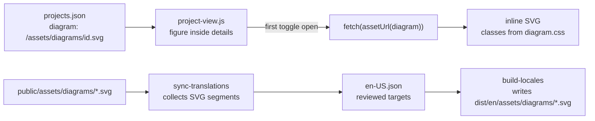

# Plan: Architecture diagrams for the private projects in production

## Approach

The catalog rows are rendered by `src/scripts/project-view.js` from `projects.json`, so the diagram is data (a path per project) plus a small rendering step, not a template change. The three SVGs are static files under `public/assets/diagrams/`, authored by hand with the same classes and viewBox as the work-page diagrams, so one stylesheet serves both. They are fetched the first time a row's disclosure opens and inserted inline, which lets them read the theme tokens (an `` cannot) and keeps the home document and the closed rows free of their bytes.

## Pieces

1. **Data**: `diagram` field on the three entries (`public/assets/data/projects.json`); the catalog `Project` interface gains `diagram?: string`.
2. **Files**: `public/assets/diagrams/<id>.svg` (720x320, six or seven boxes, prefixed ids) and `docs/assets/diagrams/project-<id>.mmd`.
3. **Styles**: the diagram rules of `work.css` move to `src/styles/diagram.css` under `.arch-diagram`, imported from `site.css`; `Architecture.astro` renames its figure class; the WK-004 assertion in `scripts/case-pages.test.mjs` reads the new file.
4. **Client**: `locale.js` exports `assetUrl(path)` (`/en` prefix on English pages; `dataUrl` reuses it); `project-view.js` adds the figure to the disclosure, swaps the summary label and fetches on the first `toggle` with `open`.
5. **Interface keys**: `projectDetailDiagram` ("Ver arquitectura y detalle") and `projectDiagram` (figure label) in `src/i18n/runtime.json`, reviewed English in `en-US.json`.
6. **Localization pipeline**: `sync-translations.mjs` parses each SVG and collects its segments (the SVG opts in with `data-translate="yes"`); `build-locales.mjs` localizes each SVG and writes `en/assets/diagrams/<id>.svg` (body-serialized, as the terminal commands are); `check-locales.mjs` asserts the English files exist and differ from the Spanish; both tolerate a missing directory so the localization fixture test keeps passing.
7. **Claims**: `check-claims.mjs` adds `public/assets/diagrams` and `.svg` to the source scan.
8. **Guard**: `scripts/private-diagrams.test.mjs`, written first, registered in `package.json` `check`.

## Verification

- Guard red on `main` (no data, no files, no styles), green after the pieces.
- `npm run check` (includes build, `check:locales`, `check:claims`, CSS-002 tripwire).
- Built site served locally: open the three rows in dark and paper, Spanish and English, 1440 and 390 px; network panel shows no diagram request before opening; axe-core on the home with the rows open; work page diagram unchanged.

## Risks

- `main.css` grows by the diagram rules (about 1.1 KB raw before gzip). The home sits at 28 140 B gzip against 30 720 B, so the margin holds; measured in `tasks.md`.
- Inline SVG `id` collisions: three diagrams may be open at once in one document, so every id is prefixed per diagram (guarded).
- Guards that fingerprint `project-view.js` (`card-system`, `inner-pages`, `portfolio-refresh`, `selected-work`, `storytelling`) read specific strings; additions do not change them, verified by `npm run check`.
