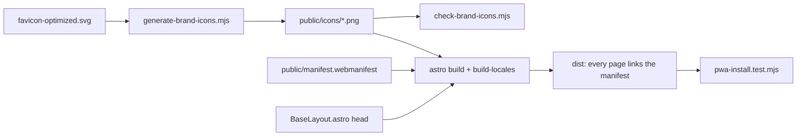

# Implementation plan: Installable site (Android and iOS)

Status: Draft

## Modules

- **Manifest**: `public/manifest.webmanifest`, a static file copied to the site root by the build. Covers
  INS-001, INS-002, INS-003.
- **Icons**: `scripts/generate-brand-icons.mjs` renders `public/icons/icon-192.png`, `icon-512.png` and
  `icon-maskable-512.png` from `public/assets/images/favicon-optimized.svg`. The maskable variant reuses the
  mark of that file on a square tile with no rounded corners and scales the mark so its round stroke caps stay
  inside the safe zone. `scripts/check-brand-icons.mjs` regenerates them in memory and compares. Covers
  INS-003, INS-004, INS-005.
- **Head tags**: `src/layouts/BaseLayout.astro`, the single layout of every page. The English build copies the
  head of the Spanish one, so both languages get the tags. Covers INS-001, INS-006.
- **Guard**: `scripts/pwa-install.test.mjs` in the post-build group of `npm run check`. Covers INS-007.

## Data model changes

None.

## Key decisions

- **Decision**: a static manifest in `public/`.
  - **Discarded alternative**: an Astro endpoint that builds the manifest from `defaultSEO`.
  - **Rationale**: the other installable products of the ecosystem ship a static file, and one test pins the
    description to `defaultSEO.description`, which removes the only reason to generate it.
- **Decision**: no service worker.
  - **Discarded alternative**: an offline shell, as Nain3D and NainOrder have.
  - **Rationale**: Chrome and iOS install without one, and a content site has nothing to gain from a cache
    that can serve an old page. Owner decision of 2026-11-13. Adding one later needs its own ADR.
- **Decision**: one manifest for both languages.
  - **Discarded alternative**: a second manifest under `/en/` with its own `id`.
  - **Rationale**: two ids on one origin are two installed apps for the same site.
- **Decision**: the status bar style is `black`.
  - **Discarded alternative**: `black-translucent`.
  - **Rationale**: the translucent style draws the page under the status bar and needs safe-area insets the
    header does not have.

## Test strategy

- Contract test (`node:test`) on the source manifest, the icon files (size, opacity, safe zone through
  `sharp`) and every HTML page of `dist/`.
- Generated-versus-committed comparison in `check:brand-icons`.
- Manual: `Page.getInstallabilityErrors` on a local preview; after the deploy, the owner's Android phone and
  iPhone.
