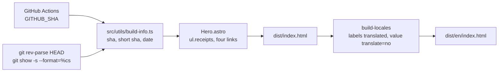

# Plan: Verifiable receipts band in the hero

## Approach

The band is static HTML inside `Hero.astro`: four links with a label and a value. Three values are constants of the repository (its name, what the checks do, what the status page shows); the fourth is resolved at build time from the commit being built, so it needs no editing and cannot drift. Nothing runs in the browser and nothing is requested from another host: the links are the verification.

## Pieces

1. **Build info**: `src/utils/build-info.ts` exports `buildInfo()` returning `{ sha, shortSha, date }`; `GITHUB_SHA` first, then `git rev-parse HEAD`; date from `git show -s --format=%cs <sha>`; throws a named error when either value does not match its pattern.
2. **Markup**: `Hero.astro` imports `buildInfo` and renders `
<ul class="receipts" aria-label="Comprobable">…</ul>
` after the hero grid: a lead span and four `<li><a target="_blank" rel="noopener noreferrer">……</a></li>`. The publication value holds `<code translate="no">` and `<time datetime translate="no">`.
3. **Styles**: a `.receipts` block after the `.scroll-cue` rules in `main.css`: flex row, wrap, top line in `--color-line`, lead and labels in the mono eyebrow style, values in `--color-text`, link colour on hover and focus, `min-height: 44px` on the links; a phone rule that gives each receipt the full row width at 36 rem.
4. **English**: `npm run translations:prepare` collects the lead, the labels and the three description values; a scratch script writes the reviewed targets into `src/i18n/en-US.json`.
5. **Guard**: `scripts/receipts-strip.test.mjs`, written first, registered in `package.json` `check` after `private-diagrams.test.mjs`.

## Verification

- Guard red on `main` (no util, no markup, no styles), green after the pieces.
- `npm run check` (build, `check:locales`, `check:claims`, CSS-002 tripwire).
- Built site served locally: both themes, Spanish and English, 1440 and 390 px; axe-core on `/` and `/en/`; the network panel shows no request to another host on load; the publication value equals `git rev-parse --short HEAD` of the worktree and is identical on `/en/`.

## Risks

- `main.css` grows by about 0.6 KB raw; the home sits at 28 217 B gzip against 30 720 B. Measured in `tasks.md`.
- Guards that fingerprint `Hero.astro` (`home-clarity`, `portfolio-refresh`, `offer-copy`, `profile-coherence`, `performance`, `hero-nav`, `storytelling`) read specific strings and the order of the existing blocks; the band is appended after the grid, so none of them should change. Verified by `npm run check`.
- The document now changes on every commit (the sha). Nothing compares builds across commits; the performance tripwire measures size only.
